# ADealForge — Architecture Design Document

**Document type:** CTO Architecture Review  
**Product:** ADealForge Lead Generation / Outbound SaaS Platform  
**Repository inspected:** `adealforge` (workspace root)  
**Inspection date:** 2026-07-23  
**Document version:** 1.0  
**Classification:** Internal — Architecture

---

## Document control

| Field             | Value                                                                          |
| ----------------- | ------------------------------------------------------------------------------ |
| Authors           | Principal Software Architect (AI-assisted repository analysis)                 |
| Audience          | CTO, Engineering leads, Product                                                |
| Status            | Draft for CTO review                                                           |
| Related artifacts | `Architecture.pdf`, `docs/architecture/diagrams/*`, Architecture review canvas |
| Evidence basis    | Static repository inspection only (no runtime production access)               |

**Reading guide**

- **Verified repository facts** — observed in source, config, or CI.
- **Architecture assumptions** — design choices required to proceed; labeled explicitly.
- **Open questions** — require stakeholder confirmation before build.
- **Not verified — requires confirmation** — claimed in brief or marketing but absent from code.
- **Recommended decisions** — proposed ADR outcomes.

---

## 1. Executive Summary

This repository is **not** a Python lead-generation application MVP. After full inspection, `adealforge` is a **production-oriented marketing website and lead-capture surface** for the ADealForge brand, built with **React + TypeScript + Vite**, deployed via **Cloudflare Workers + static assets**, with a single API endpoint (`POST /api/contact`) that verifies Cloudflare Turnstile and stores inquiry leads in **Cloudflare KV**.

The project brief described folders and subsystems (`rust_core/`, `alembic/`, Python workers, scrapers, campaign engines, queues) that **do not exist in this repository**. Those items are labeled **Not verified — requires confirmation** and treated as either a different codebase, an uncommitted system, or aspirational product scope.

**Strategic recommendation**

1. **Keep** this repository as the **Acquisition / Marketing** application (brand site, SEO landings, contact funnel).
2. **Create a new monorepo** (or sibling repos under one org) for the **SaaS product**: NestJS Main API, Data Collection service, React/Next app, Prisma/PostgreSQL, Redis/BullMQ.
3. **Do not attempt** to “migrate Python services from this repo” — there are none to migrate here.
4. Treat marketing workflow copy and UI mockups as **product domain signals**, not as implemented backend behavior.
5. Ship an **MVP on one VPS + Docker Compose + Cloudflare** (no AWS, no Kubernetes), with clear scale-out seams.

**Reuse vs rewrite (headline)**

| Category                                                                                                            | Verdict                             |
| ------------------------------------------------------------------------------------------------------------------- | ----------------------------------- |
| Brand, marketing IA, i18n content model, SEO landings, contact funnel, CI quality gates, Cloudflare hosting pattern | **Reuse / evolve**                  |
| Product mockups, live campaign simulation, pricing A/B localStorage                                                 | **Reference only** (UX inspiration) |
| SaaS auth, tenants, prospects, campaigns, scraping, AI agent, billing, queues                                       | **Greenfield write** (absent here)  |
| Unused AI Studio scaffolding (`@google/genai`, `express`, `GEMINI_API_KEY` unused in app code)                      | **Remove / clean**                  |

---

## 2. Current Repository Analysis

### 2.1 Verified repository facts

#### Identity and purpose

- Package name: `react-example` (legacy AI Studio scaffold naming).
- Brand in UI/copy: **ADealForge**.
- Public domain referenced in code: `https://adealforge.com`.
- README describes “AI Studio app” + Cloudflare Worker contact form + quality tooling.
- Product positioning in copy: managed B2B outbound, prospecting, enrichment, personalized email, campaign delivery — largely **service/marketing language**.

#### Technology actually present

| Layer           | Verified stack                                                                      |
| --------------- | ----------------------------------------------------------------------------------- |
| Frontend        | React 19, TypeScript ~5.8, Vite 6, Tailwind CSS 4, Lucide icons                     |
| i18n            | i18next + react-i18next; locales: `en`, `de`, `es`, `fr`, `it`, `pt`, `ru`, `zh`    |
| Edge backend    | Cloudflare Worker (`worker/index.ts`)                                               |
| Storage         | Cloudflare KV binding `LEADS_KV`                                                    |
| Bot protection  | Cloudflare Turnstile (client widget + server `siteverify`)                          |
| Analytics       | Optional GA4 after cookie consent (`src/lib/analytics.ts`)                          |
| Cookies         | `vanilla-cookieconsent`                                                             |
| SEO             | Post-build static landing generator (`scripts/generate-landing-pages.mjs`)          |
| Tests           | Playwright smoke E2E (`e2e/`)                                                       |
| CI              | GitHub Actions: typecheck, ESLint, Prettier, build, Playwright, commitlint          |
| Node CI version | 22                                                                                  |
| Quality hooks   | Husky pre-commit (`lint-staged` + `npm run check`), Commitlint conventional commits |

#### Application routes (SPA + Worker rewrites)

Verified public paths handled by Worker and/or `App.tsx`:

| Path                                           | Behavior                                               |
| ---------------------------------------------- | ------------------------------------------------------ |
| `/`                                            | Homepage V3 (production default)                       |
| `/contact`                                     | Contact page (SPA rewrite to `/`)                      |
| `/platform`                                    | Platform page — **explicitly “under construction”** UI |
| `/workflow`                                    | Workflow dashboard mockup (`MainProductMockup`)        |
| `/terms`                                       | Terms page                                             |
| `/blog` and `/blog/*`                          | SPA rewrite (blog content surface exists in nav/copy)  |
| `/homepage-v1`, `/homepage-v2`, `/homepage-v3` | 301 to `/`                                             |
| `/landing/{slug}/`                             | Static programmatic SEO pages in `dist/landing`        |
| `POST /api/contact`                            | Only JSON API                                          |

Landing slugs verified: `b2b-lead-generation`, `outbound-sales-automation`, `cold-email-outreach-service`, `b2b-prospecting-software`, `managed-outbound-services`, `ai-lead-generation`, `sales-pipeline-generation`, `b2b-appointment-setting`.

#### Contact / lead capture flow (only real backend workflow)

1. Browser loads Turnstile; user submits name, email, message.
2. Honeypot field `website` — if filled, Worker returns `{ ok: true }` without storing (bot decoy).
3. Worker validates JSON, lengths, email regex.
4. Turnstile verified via Cloudflare API using `TURNSTILE_SECRET_KEY` and `CF-Connecting-IP`.
5. Lead stored in KV: key `lead:<ISO-timestamp>:<uuid>`, JSON payload `{ id, submittedAt, name, email, message, host, pathname }`.

#### Frontend product surfaces that are **not** backends

- `MainProductMockup` — staged UX simulation: Discovery → Enrichment → Contacts → Review → Personalization → Outreach.
- `useLiveCampaignSimulation` — client-only animation of campaign rows/progress.
- Pricing A/B (`pricingAbTest.ts`) — localStorage random assignment of monthly price variants.
- One-time leads packages (`homepageOneTimeLeadsPricing.ts`) — **explicit PLACEHOLDER** commercial values.
- Platform page `statusNote` — under construction.

#### Source inventory (approx.)

- `src/` ≈ 90 source files (components, i18n, lib, content).
- `worker/index.ts` ≈ 188 lines — sole application backend.
- No `docker-compose.yml`, no `Dockerfile`, no `alembic/`, no `rust_core/`, no Prisma schema, no NestJS app, no Redis, no BullMQ, no PostgreSQL models.

#### Dependencies of note

- `@google/genai` and `express` are in `package.json` but **no application import usage was found** in `src/` or `worker/` (verified by search). Treat as scaffold leftovers unless confirmed otherwise.
- `GEMINI_API_KEY` appears in `.env.example` / README AI Studio notes — **not wired** into app code found.

#### Python in repo

- `scripts/process-logo-transparent.py` — image utility.
- `.agents/skills/**/scripts/*.py` — SEO agent skill tooling, **not** product runtime.

### 2.2 What the brief expected vs what exists

| Brief expectation            | Repository reality                     |
| ---------------------------- | -------------------------------------- |
| Python MVP                   | Not present as application             |
| `rust_core/`                 | Missing                                |
| `alembic/` migrations        | Missing                                |
| Workers / queues / pipelines | Missing (except CF Worker for contact) |
| Scraping / LinkedIn / Maps   | Missing                                |
| Campaign execution engine    | Missing (UI simulation only)           |
| AI email generation backend  | Missing                                |
| Auth / orgs / billing        | Missing                                |
| Database                     | KV only for contact leads              |

### 2.3 Reuse / rewrite / remove / extract

#### Reuse (belongs in new SaaS ecosystem)

1. **Marketing site** as acquisition channel — keep Cloudflare deployment, Turnstile, GA consent model.
2. **Brand & copy system** (`content/marketingCopy.ts`, i18n locales) — domain vocabulary for product UX.
3. **Programmatic SEO generator** — evolve into marketing package in monorepo.
4. **CI quality bar** — typecheck/lint/format/E2E pattern transferable.
5. **Workflow stage taxonomy** (discovery → outreach) — candidate product pipeline states.
6. **Contact lead schema** — migrate KV leads into CRM/`LeadInquiry` table later.

#### Rewrite (greenfield in NestJS platform)

1. Multi-tenant identity, orgs, workspaces, RBAC.
2. Prospects / companies / contacts data model.
3. Data collection & enrichment service.
4. Campaigns, sequences, send orchestration (future).
5. AI agent with tool calling.
6. Billing/subscriptions.
7. Realtime job progress (SSE).
8. Exports (CSV/CRM).

#### Remove / clean in this repo

1. Unused `@google/genai`, `express` if confirmed unused.
2. AI Studio README framing once product docs exist.
3. Placeholder WhatsApp default `1234567890` if not intentional.
4. Dead homepage V1/V2 routes already redirected — consider archiving components after confirmed unused.

#### Independent microservice candidates (target architecture)

1. **Main API Service** — tenants, CRM objects, campaigns, AI orchestration, billing.
2. **Data Collection Service** — scrape/enrich/import only.
3. **Future:** Email Delivery Service, Enrichment Provider Adapter, Automation Engine, Billing Webhook Worker, Notification Service.

### 2.4 Folder map (verified)

```text
adealforge/
  .agents/skills/     # Marketing/SEO agent skills (not runtime SaaS)
  .github/workflows/  # CI
  .husky/             # Git hooks
  dist/               # Build output
  e2e/                # Playwright
  public/             # Static brand assets
  scripts/            # Landing generation, locale helpers, logo script
  src/                # React SPA
  worker/             # Cloudflare Worker (contact + SPA rewrites)
  package.json
  vite.config.ts
  wrangler.toml
  README.md
```

**Absent (verified missing):** `alembic/`, `rust_core/`, `docs/` (pre-existing product docs), Docker, Prisma, Nest apps, queue workers, DB migrations.

---

## 3. Migration Strategy

### 3.1 Principle

This is a **platform introduction**, not a strangler migration of an in-repo Python monolith. Marketing remains; SaaS is built alongside.

### 3.2 Phased approach

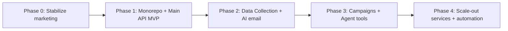

| Phase | Goal                                      | Outcome                                  |
| ----- | ----------------------------------------- | ---------------------------------------- |
| 0     | Keep website shipping; document truth     | This Architecture doc; clean unused deps |
| 1     | Auth, orgs, prospects CRUD, imports       | Usable multi-tenant core                 |
| 2     | Collection jobs + AI generation           | Differentiated product loop              |
| 3     | Campaigns + agent tool calling            | Apollo/Instantly-like core loop          |
| 4     | Split hot paths; automation builder hooks | Scale + extensibility                    |

### 3.3 Data migration

- **KV contact leads:** export script → PostgreSQL `lead_inquiries` (optional CRM).
- **No prospect/campaign DB** exists here to migrate.
- If a separate Python MVP exists elsewhere: **Not verified — requires confirmation**. Establish inventory before any port.

### 3.4 Cutover

- Keep `adealforge.com` marketing on Cloudflare.
- Host SaaS on `app.adealforge.com` (assumption) behind Cloudflare Tunnel / reverse proxy.
- Shared brand tokens; separate auth cookies (no shared session with marketing KV).

---

## 4. Technology Stack

### 4.1 Target stack (recommended)

| Area                          | Choice                                                                    |
| ----------------------------- | ------------------------------------------------------------------------- |
| Marketing frontend (existing) | React + Vite + Cloudflare Workers (keep)                                  |
| Product frontend              | Next.js (App Router) + React + TS + TanStack Query + Tailwind + shadcn/ui |
| Main API                      | NestJS + Prisma + PostgreSQL                                              |
| Jobs                          | BullMQ + Redis                                                            |
| Realtime                      | Server-Sent Events (SSE)                                                  |
| Data Collection               | NestJS worker service (separate process/container)                        |
| Object storage                | Cloudflare R2                                                             |
| CDN / WAF / DNS               | Cloudflare                                                                |
| Edge tunnel                   | Cloudflare Tunnel                                                         |
| Reverse proxy                 | Traefik or Nginx on VPS                                                   |
| Deploy                        | Docker Compose on Hetzner / Hostinger / DigitalOcean VPS                  |
| CI/CD                         | GitHub Actions                                                            |
| Observability MVP             | Structured logs + Uptime + optional Grafana/Loki later                    |

### 4.2 Technology matrix

| Capability  | MVP                          | Scale path                          |
| ----------- | ---------------------------- | ----------------------------------- |
| App serving | 1 VPS Docker Compose         | Multiple VPS / managed PG           |
| DB          | Single PostgreSQL            | Read replicas, partitioning         |
| Queue       | Single Redis + BullMQ        | Queue per domain, dedicated workers |
| Files       | R2                           | Same                                |
| Realtime    | SSE on Main API              | Dedicated realtime gateway          |
| Search      | Postgres `pg_trgm` / filters | OpenSearch later                    |
| Email send  | Provider API (assumption)    | Dedicated delivery service          |

---

## 5. Assumptions and Open Questions

### 5.1 Assumptions and Open Questions _(Boss requirement §1)_

#### Architecture assumptions

1. The SaaS product will be **greenfield** in Node/NestJS; this repo remains marketing unless product UI is later merged into a monorepo apps folder.
2. Multi-tenancy is **organization → workspace** scoped; all business data is tenant-isolated via `organizationId` (and optionally `workspaceId`).
3. MVP will **not** send cold email at massive scale on day one; it will support list building, enrichment jobs, AI email draft generation, and campaign **orchestration records** (send may be provider-backed).
4. Legal bases for scraping/enrichment and cold outreach vary by region; compliance gates are mandatory extension points.
5. Single-region EU or US VPS is acceptable for MVP (**open**: exact region).
6. Cloudflare remains the edge for DNS/CDN/WAF/R2/Tunnel.
7. “AI Agent” MVP = chat + tool calling against Main API domain tools (not a separate agent OS).
8. No-code automation is **post-MVP**; only event/webhook/workflow extension points now.
9. Billing provider will be Stripe (**assumption** — not in repo).
10. LinkedIn automation, if any, is high-risk legally/technically — treat as Phase 3+ with explicit legal review.

#### Open questions

1. Does a separate Python/`rust_core` MVP repository exist? If yes, where is the source of truth?
2. Target launch geography and data residency requirements (GDPR, etc.)?
3. Will ADealForge sell **self-serve SaaS**, **managed service**, or hybrid (marketing currently emphasizes managed outbound)?
4. Email sending: native infrastructure vs Instantly/Smartlead-style vs ESP (SendGrid/Postmark)?
5. Preferred ICP verticals for Data Collection v1 (gov registries, Maps, directories)?
6. SSO requirement for MVP (Google/Microsoft)?
7. Seat-based vs credit-based billing for enrichment/AI?
8. Must marketing and app share one monorepo immediately?
9. Acceptable monthly infra ceiling for MVP (see cost section defaults)?
10. Who owns deliverability/domain warming — product or services team?

#### Explicit non-claims

| Claim                                  | Status                                                |
| -------------------------------------- | ----------------------------------------------------- |
| Existing scraper pipeline in this repo | **Not verified — requires confirmation**              |
| Existing campaign sender               | **Not verified — requires confirmation**              |
| Existing user auth                     | **Not verified — requires confirmation** (absent)     |
| Existing PostgreSQL schema             | **Not verified — requires confirmation** (absent)     |
| Gemini already integrated in product   | **Not verified — requires confirmation** (dep unused) |

---

## 6. Functional Requirements

### 6.1 Functional Requirements _(Boss requirement §2)_

#### FR-MKT (existing marketing — preserve)

- FR-MKT-1: Public marketing pages render on desktop/mobile.
- FR-MKT-2: Contact form submits to `/api/contact` with Turnstile.
- FR-MKT-3: Leads persist durably (today: KV).
- FR-MKT-4: Programmatic SEO landing pages generate at build.
- FR-MKT-5: Cookie consent gates analytics.
- FR-MKT-6: Multi-language UI strings via i18n.

#### FR-IAM (new SaaS)

- FR-IAM-1: Email/password and/or OAuth signup/login.
- FR-IAM-2: Organization create/invite; roles Owner/Admin/Member/Viewer.
- FR-IAM-3: Workspace isolation within organization.
- FR-IAM-4: Session revocation; password reset.

#### FR-CRM

- FR-CRM-1: CRUD companies and persons (prospects).
- FR-CRM-2: Tags, lists, segments, saved filters.
- FR-CRM-3: Deduplicate by domain/email heuristics.
- FR-CRM-4: CSV import/export.
- FR-CRM-5: Manual enrichment fields + enrichment job status.

#### FR-COLLECT (Data Collection Service)

- FR-COLLECT-1: Enqueue collection jobs (URL, Maps query, registry query, CSV).
- FR-COLLECT-2: Respect rate limits, retries, DLQ.
- FR-COLLECT-3: Normalize into company/contact entities.
- FR-COLLECT-4: Provider adapters interface (scrapers, APIs).
- FR-COLLECT-5: Per-tenant quotas and kill switches.

#### FR-AI

- FR-AI-1: Generate personalized email drafts from company context.
- FR-AI-2: Regenerate with instructions.
- FR-AI-3: Chat agent with tool calling (search prospects, create tasks, draft email, launch/pause campaign).
- FR-AI-4: Stream tokens/progress to UI (SSE).
- FR-AI-5: Persist generations with prompt/model metadata for audit.

#### FR-CAMP

- FR-CAMP-1: Create campaign from list + sequence steps.
- FR-CAMP-2: Launch / pause / resume.
- FR-CAMP-3: Track per-prospect step state.
- FR-CAMP-4: MVP may mark messages “ready to send” or call external sender API (**assumption**).

#### FR-BILL

- FR-BILL-1: Plans/subscriptions; entitlement checks.
- FR-BILL-2: Usage meters (AI tokens, enrichments, seats).

#### FR-EXT (future automation — extension only)

- FR-EXT-1: Domain events published for workflow engine later.
- FR-EXT-2: Webhook subscriptions per tenant.
- FR-EXT-3: Tool registry usable by agent and future graph runner.

---

## 7. Non-Functional Requirements

### 7.1 Non-Functional Requirements _(Boss requirement §3)_

| ID        | Requirement            | MVP target                                         |
| --------- | ---------------------- | -------------------------------------------------- |
| NFR-COST  | Low monthly infra cost | ≤ ~$40–80 VPS+CF free/low tier (see §34)           |
| NFR-DEP   | Simple deploy          | Docker Compose, no K8s, no AWS                     |
| NFR-SEC   | Tenant isolation       | Mandatory row-level org scoping                    |
| NFR-AVL   | Availability           | Best-effort single VPS + backups                   |
| NFR-PERF  | API p95                | < 300ms for CRUD reads on warm DB                  |
| NFR-JOB   | Job visibility         | SSE progress for long tasks                        |
| NFR-SCALE | Design for 10k+ users  | Horizontal worker/API seams without rewrite        |
| NFR-OBS   | Debuggability          | Structured JSON logs, request IDs                  |
| NFR-PRIV  | Privacy                | Consent, retention, export/delete hooks            |
| NFR-I18N  | Product UI             | English MVP; reuse marketing i18n later            |
| NFR-DR    | Backups                | Daily PG dump to R2                                |
| NFR-IDEMP | Safe retries           | Idempotency keys on job enqueue & billing webhooks |

---

## 8. Domain Model

### 8.1 Domain Model _(Boss requirement §4)_

#### Core entities (target SaaS)

| Entity                     | Description                                   |
| -------------------------- | --------------------------------------------- |
| User                       | Authenticated human                           |
| Organization               | Billing/tenant boundary                       |
| Membership                 | User↔Org role                                 |
| Workspace                  | Optional sub-tenant / project space           |
| Project                    | Named initiative inside workspace             |
| Company                    | Account / firmographic record                 |
| Person                     | Contact at company                            |
| ProspectList               | Named set of companies/people                 |
| EnrichmentProfile          | Structured research payload                   |
| CollectionJob              | Async data gathering unit                     |
| CollectionSource           | Adapter type + config                         |
| EmailAsset                 | Generated or edited email                     |
| Campaign                   | Outreach container                            |
| CampaignMembership         | Prospect in campaign                          |
| SequenceStep               | Ordered touch definition                      |
| CampaignEvent              | Send/open/reply/etc.                          |
| AgentThread / AgentMessage | AI chat history                               |
| AgentToolCall              | Tool invocation audit                         |
| Task                       | Human/agent created work item                 |
| Subscription / UsageLedger | Billing                                       |
| AuditLog                   | Security/compliance trail                     |
| LeadInquiry                | Marketing contact form lead (from today’s KV) |

#### Pipeline states (from verified UX taxonomy)

`discovery → enrichment → contacts → review → personalization → outreach`

These are **product language verified in UI mockups**, not existing DB enums.

#### Domain invariants

1. Every Company/Person/Campaign/Job belongs to exactly one Organization.
2. Campaign launch requires at least one membership in `ready` state (**assumption**).
3. Tool calls execute only with caller’s tenant credentials.
4. Soft-delete preferred for CRM entities; hard-delete via GDPR workflow.

---

## 9. Bounded Contexts

| Context           | Ownership                    | Service                            |
| ----------------- | ---------------------------- | ---------------------------------- |
| Identity & Access | Users, sessions, RBAC        | Main API                           |
| Tenant & Billing  | Orgs, plans, entitlements    | Main API (+ Stripe webhooks)       |
| CRM               | Companies, people, lists     | Main API                           |
| Collection        | Crawl/enrich/import          | Data Collection Service            |
| Generation        | LLM drafts, embeddings later | Main API (AI module)               |
| Outreach          | Campaigns/sequences          | Main API → future Delivery Service |
| Agent             | Chat + tools                 | Main API                           |
| Acquisition       | Marketing site, SEO, contact | Existing Cloudflare app            |
| Automation        | Future workflow graph        | Future Automation Service          |

Anti-corruption: Collection service emits **normalized DTOs**; Main API owns canonical CRM writes.

---

## 10. System Context Diagram

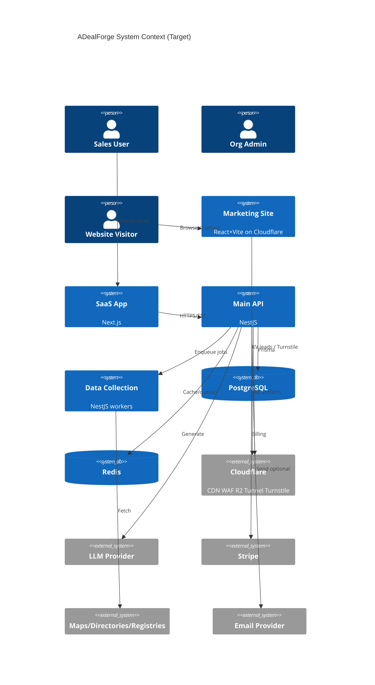

Fallback simplified:

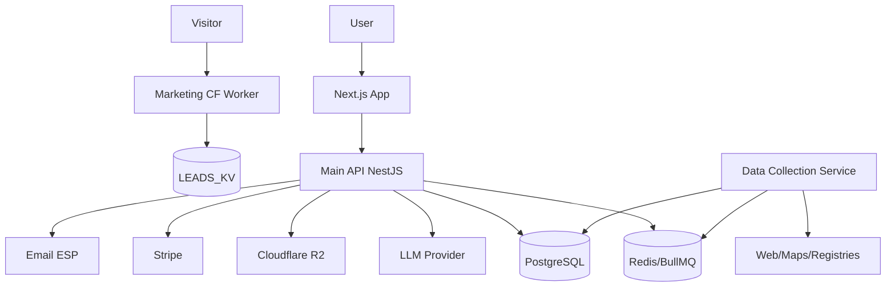

---

## 11. Component Diagram

### 11.1 Component Diagram _(Boss requirement §5)_

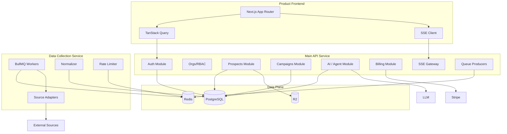

#### Main API internal modules

- `AuthModule`, `UsersModule`, `OrganizationsModule`, `WorkspacesModule`
- `CompaniesModule`, `PeopleModule`, `ListsModule`, `ImportsModule`
- `CampaignsModule`, `SequencesModule`
- `AiModule` (generation), `AgentModule` (tools + threads)
- `BillingModule`, `AdminModule`, `HealthModule`
- `EventsModule` (domain events → Redis streams / outbox)

#### Data Collection adapters (interface)

```text
CollectionAdapter {
  name: 'website' | 'maps' | 'registry' | 'csv' | 'linkedin'?*
  enqueue(job): void
  run(job): CollectionResult
}
```

`linkedin` marked high-risk — **Not verified product requirement for MVP**.

---

## 12. Deployment Architecture

### 12.1 Deployment Architecture _(Boss requirement §10)_

#### MVP topology (single VPS)

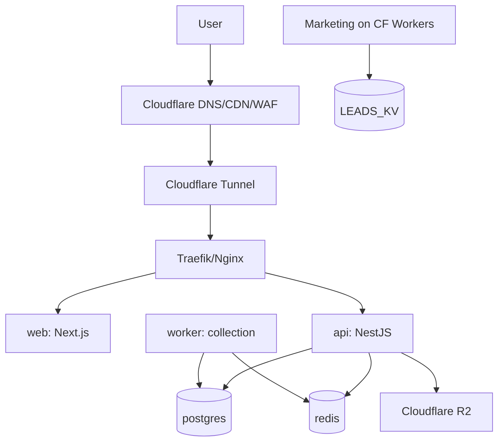

#### Containers (Compose)

| Service             | Image role                         |
| ------------------- | ---------------------------------- |
| `traefik` / `nginx` | TLS termination from Tunnel        |
| `web`               | Next.js standalone                 |
| `api`               | NestJS Main API                    |
| `worker`            | Data Collection + BullMQ consumers |
| `postgres`          | PG 16                              |
| `redis`             | Redis 7                            |
| `backup` (cron)     | pg_dump → R2                       |

#### Scaling path (later)

1. Split `worker` replicas by queue name.
2. Move PostgreSQL to managed (or dedicated VPS).
3. Add second API replica + sticky-less SSE via Redis pub/sub.
4. Only then consider K8s / cloud ASGs.

#### Deployment Diagram (logical)

See diagram above; physical: 1× Hetzner CX33 or DigitalOcean $24–48 droplet; marketing remains on Cloudflare (near-zero marginal cost).

---

## 13. Backend Architecture Diagram

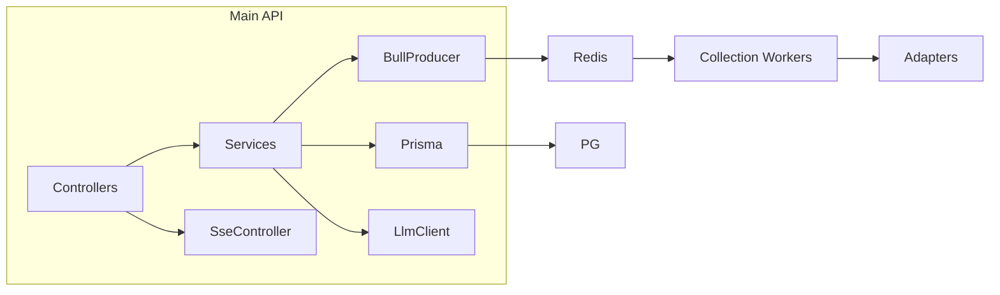

**Process model MVP:** 2 Node processes (`api`, `worker`) sharing one codebase monorepo packages, different entrypoints — lowest ops cost while preserving future split.

---

## 14. Frontend Architecture

### 14.1 Two frontends

| App                   | Stack    | Role               |
| --------------------- | -------- | ------------------ |
| Marketing (this repo) | Vite SPA | Acquisition        |
| Product (new)         | Next.js  | Authenticated SaaS |

### 14.2 Product app structure

```text
apps/web/
  app/(marketing-redirect)/
  app/(auth)/login|signup
  app/(app)/dashboard
  app/(app)/prospects
  app/(app)/campaigns
  app/(app)/agent
  app/(app)/settings
  components/ui (shadcn)
  lib/api.ts
  lib/sse.ts
  hooks/queries/*
```

### 14.3 Data fetching

- TanStack Query for REST.
- SSE for job/campaign/agent streams.
- Optimistic updates for list edits; invalidated on job completion events.

### 14.4 Why Next.js for product (summary)

SSR/SEO for sparse public product pages, file-system routing, React Server Components where useful, easy auth cookie patterns — while marketing SPA can remain Vite on CF.

---

## 15. Data Architecture

### 15.1 Data Architecture _(Boss requirement §8)_

#### Database Architecture

- Single PostgreSQL instance.
- Prisma schema as source of truth.
- Soft deletes + `createdAt`/`updatedAt`.
- Outbox table for reliable domain events.
- Job tables mirror BullMQ for user-visible history (BullMQ is execution; PG is audit).

#### Caching Strategy (preview; full in §22)

- Redis: sessions (optional), rate limits, job state, short-lived query cache.
- HTTP cache only for public marketing (CF).
- Do not cache tenant CRM without org key prefix.

#### Object storage

- R2: CSV imports, export artifacts, attachment blobs, backup dumps.

#### Entity Relationship Overview

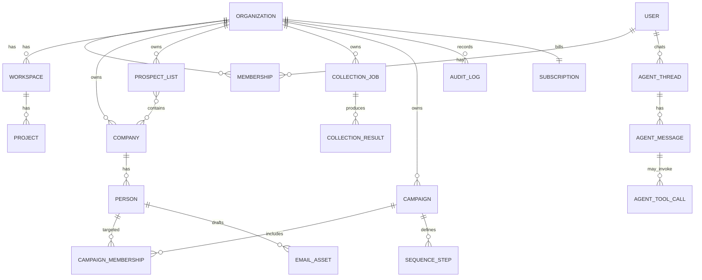

#### Marketing lead model (current)

```text
KV key: lead:<iso>:<uuid>
value: { id, submittedAt, name, email, message, host, pathname }
```

---

## 16. Data Flow

### 16.1 Collection → CRM

1. User creates CollectionJob in UI.
2. Main API authorizes + writes job row + enqueues BullMQ.
3. Worker runs adapter with rate limit.
4. Normalizer upserts Company/Person in tenant scope.
5. SSE notifies UI; job completes or DLQ.

### 16.2 AI generation

1. User selects persons + tone.
2. API loads context, checks entitlements, calls LLM.
3. Persists EmailAsset; streams tokens via SSE.
4. Usage ledger incremented.

### 16.3 Campaign launch

1. Validate memberships ready.
2. Transition campaign `draft → running`.
3. Enqueue step scheduler jobs.
4. Sender adapter executes or marks external sync.
5. Events appended; UI streams stats.

---

## 17. Sequence Diagrams

### 17.1 Sequence Diagrams _(Boss requirement §6)_

#### 17.1.1 Data collection flow

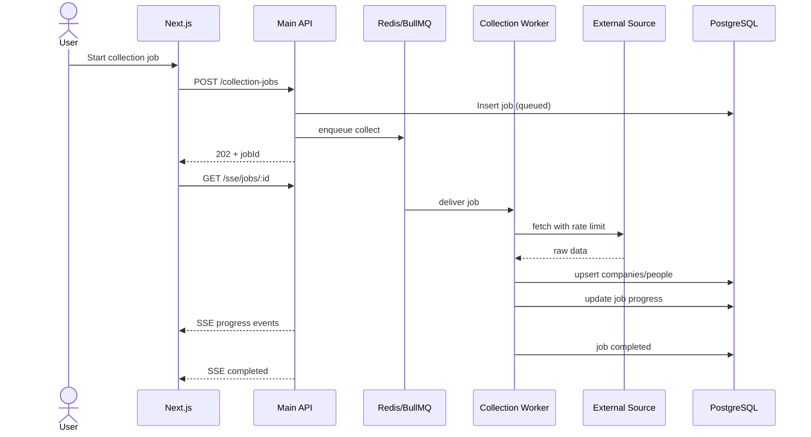

#### 17.1.2 AI email generation flow

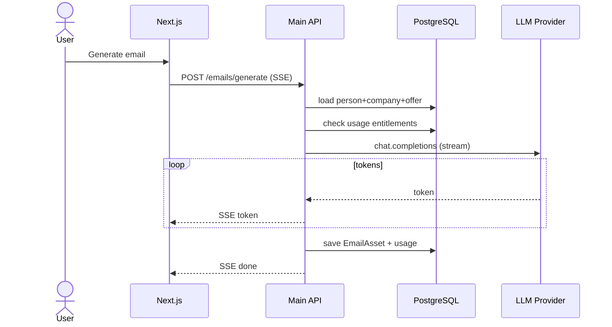

#### 17.1.3 AI agent chat and tool execution flow

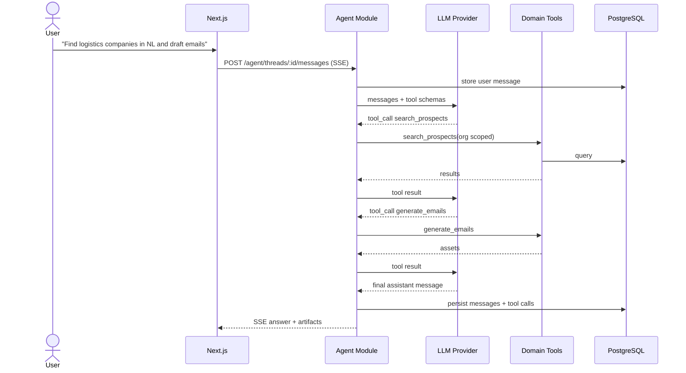

#### 17.1.4 Campaign launch flow

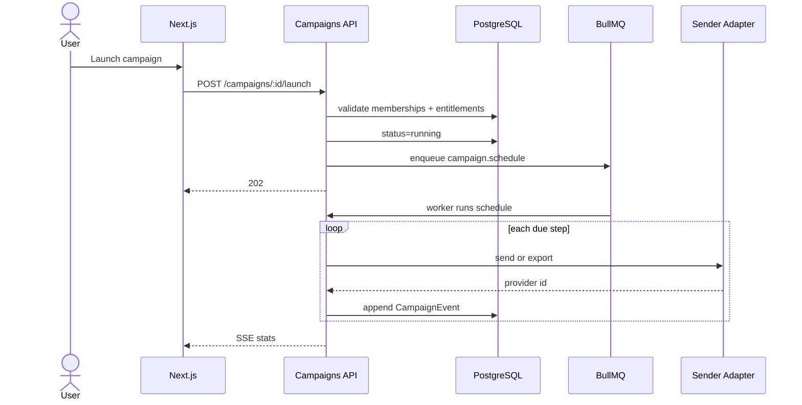

---

## 18. Security and Multi-Tenancy

### 18.1 Security and Multi-Tenancy _(Boss requirement §9)_

#### Authentication

- Access + refresh tokens (httpOnly secure cookies) or Bearer JWT for API (**decision in ADR set: cookies for web**).
- OAuth optional Phase 2.
- Turnstile remains on public marketing forms.

#### Authorization / RBAC

| Role   | Powers                               |
| ------ | ------------------------------------ |
| Owner  | Billing, delete org, all             |
| Admin  | Manage members, campaigns, jobs      |
| Member | CRM + generate + launch if permitted |
| Viewer | Read-only                            |

Enforce in Nest guards + service-layer org checks (defense in depth).

#### Tenant isolation

- Every table carrying tenant data includes `organizationId`.
- Prisma middleware / extension rejects queries missing tenant scope in application services.
- No cross-tenant tool execution.

#### Secrets

- VPS: Docker secrets / env files outside git.
- CF: Worker secrets for Turnstile.
- Never store LLM keys in frontend.

#### Rate limiting

- Edge: Cloudflare.
- API: Redis token bucket per IP + per user + per org.
- Collection adapters: per-source limits.

#### Audit logs

- Login, role changes, exports, campaign launch, agent tool calls, billing changes.

#### Existing verified controls (marketing)

- Turnstile server-side verify.
- Honeypot field.
- Input length limits.
- `cache-control: no-store` on API JSON.

---

## 19. Failure Scenarios

### 19.1 Failure Scenarios _(Boss requirement §7)_

| Scenario                 | Handling                                                                     |
| ------------------------ | ---------------------------------------------------------------------------- |
| LLM timeout              | Retry with backoff; mark generation failed; no partial save without finalize |
| Scraper 429              | Respect Retry-After; requeue delayed                                         |
| Scraper hard fail        | Attempts → DLQ; surface error                                                |
| Redis down               | API degraded mode for CRUD; reject new jobs                                  |
| Postgres down            | Hard fail healthcheck; Traefik out of pool                                   |
| Duplicate job submit     | Idempotency-Key header + unique job hash                                     |
| Double campaign launch   | Conditional update `WHERE status=draft`                                      |
| Worker crash mid-job     | BullMQ retry; adapters must be idempotent upserts                            |
| SSE disconnect           | Client reconnect with `Last-Event-ID`                                        |
| Stripe webhook duplicate | Event id uniqueness table                                                    |
| KV contact storm         | CF rate limits + Turnstile                                                   |

#### Patterns

- **Retries:** exponential backoff + jitter (BullMQ).
- **Timeouts:** per-adapter and per-LLM call budgets.
- **DLQ:** `collection-dlq`, `campaign-dlq`.
- **Idempotency:** keys on enqueue and webhooks.
- **Duplicate protection:** unique constraints on `(organizationId, domain)`, `(organizationId, email)`.
- **Circuit breakers:** trip source adapter after N failures; half-open probe.

---

## 20. Caching Strategy

| Data                    | Store          | TTL            | Notes                              |
| ----------------------- | -------------- | -------------- | ---------------------------------- |
| Session/revocation      | Redis          | session length |                                    |
| Rate limit counters     | Redis          | window         |                                    |
| Org entitlements        | Redis          | 60s            | invalidate on billing change       |
| Public marketing assets | CF CDN         | long           | fingerprinted                      |
| CRM lists               | optional Redis | 15–60s         | key = org+query hash               |
| LLM results             | PG only        | n/a            | avoid silent stale personalization |

---

## 21. Monitoring

MVP:

- `/health` + `/ready` (PG+Redis).
- Uptime robot / Cloudflare health.
- Error tracking: Sentry (**assumption** optional).
- Queue depth gauges from BullMQ.

Later: Prometheus + Grafana + Loki.

---

## 22. Logging

- JSON structured logs: `timestamp`, `level`, `service`, `requestId`, `organizationId`, `userId`, `jobId`.
- No raw PII in logs by default (hash emails).
- Agent tool calls logged in DB audit, not only stdout.

---

## 23. Infrastructure

| Component           | MVP choice               | Why                               |
| ------------------- | ------------------------ | --------------------------------- |
| Compute             | Hetzner/DO/Hostinger VPS | Cost                              |
| Edge                | Cloudflare               | Already used                      |
| Tunnel              | Cloudflare Tunnel        | Avoid public VPS ports complexity |
| Storage             | R2                       | Cost/egress                       |
| Email transactional | Provider TBD             | Password reset etc.               |
| Backups             | pg_dump → R2 nightly     | DR                                |

No AWS/K8s in MVP.

---

## 24. Deployment

1. GitHub Actions builds images or deploy artifacts.
2. SSH/Tunnel-triggered `docker compose pull && up -d`.
3. Prisma migrate on api container start (careful locking).
4. Marketing separately: `wrangler deploy`.

---

## 25. CI/CD

Reuse verified patterns from this repo:

- Node 22, `npm ci`, typecheck, lint, format, build, e2e.
- Extend with: Prisma validate, API unit tests, Playwright against web, container build scan.

Environments: `preview` (optional), `staging`, `production`.

---

## 26. Architecture Decision Records

### 26.1 Architecture Decision Records _(Boss requirement §11)_

Each ADR includes Context, Decision, Alternatives, Benefits, Trade-offs, Risks, Consequences.

---

### ADR-001: NestJS for Main API and Workers

- **Context:** Need modular Node backend for multi-tenant SaaS with clear module boundaries and DI for testability.
- **Decision:** Use NestJS for Main API and Data Collection worker entrypoints.
- **Alternatives considered:** Express/Fastify bare; Python FastAPI; Nest only API + separate Go workers.
- **Benefits:** Structure, guards/interceptors, ecosystem, TypeScript shared types with frontend.
- **Trade-offs:** More boilerplate than Express; heavier than serverless CF Workers.
- **Risks:** Over-modularization early.
- **Consequences:** Team standardizes on TS end-to-end; Python not required for core SaaS.

---

### ADR-002: BullMQ for background jobs

- **Context:** Collection, campaign scheduling, imports are async and must retry.
- **Decision:** Redis + BullMQ.
- **Alternatives:** RabbitMQ, SQS, PG job tables only, Cloudflare Queues.
- **Benefits:** Simple with Redis already planned; delays, repeats, DLQ patterns; great Node DX.
- **Trade-offs:** Redis becomes critical dependency; not multi-region by default.
- **Risks:** Redis memory pressure from large payloads — store payloads in PG/R2, queues hold IDs.
- **Consequences:** Workers scale horizontally by queue.

---

### ADR-003: Prisma ORM

- **Context:** Need productive schema migrations and type-safe queries for PostgreSQL.
- **Decision:** Prisma.
- **Alternatives:** TypeORM, Drizzle, Knex, raw SQL.
- **Benefits:** DX, migrations, typing.
- **Trade-offs:** Complex queries/CTEs sometimes awkward; middleware tenant enforcement must be disciplined.
- **Risks:** N+1 if unchecked — use include discipline and query metrics.
- **Consequences:** Schema lives in `prisma/schema.prisma`.

---

### ADR-004: Server-Sent Events for realtime

- **Context:** Job progress, agent streaming, campaign stats need push updates.
- **Decision:** SSE from NestJS (not Socket.IO for MVP).
- **Alternatives:** Socket.IO, WebSockets, polling.
- **Benefits:** HTTP-friendly, simpler auth with cookies, excellent for one-way LLM streams; fewer moving parts.
- **Trade-offs:** Weaker bi-directional messaging; proxy buffering must be disabled.
- **Risks:** Connection churn on poor networks — design reconnect.
- **Consequences:** Document Traefik/Nginx SSE timeouts.

---

### ADR-005: Monorepo

- **Context:** Multiple apps/services sharing types and lint rules.
- **Decision:** Monorepo (`pnpm` workspaces or Nx) containing `web`, `api`, `worker`, `packages/*`.
- **Alternatives:** Polyrepo; keep marketing separate forever.
- **Benefits:** Atomic changes across API+UI; shared DTOs.
- **Trade-offs:** CI complexity; access control across teams.
- **Risks:** Bloated pipelines — use affected builds.
- **Consequences:** Marketing may remain separate repo initially (this one) and join later.

---

### ADR-006: PostgreSQL as system of record

- **Context:** Relational CRM + tenancy + billing needs strong consistency.
- **Decision:** Single PostgreSQL for MVP.
- **Alternatives:** MongoDB, Cockroach, Supabase-only, SQLite.
- **Benefits:** Mature, Prisma support, constraints for dedupe.
- **Trade-offs:** Vertical scaling limits eventually.
- **Risks:** Large text/HTML in rows — move blobs to R2.
- **Consequences:** All services share logical DB; schemas/search_path optional later.

---

### ADR-007: Redis

- **Context:** Need cache, rate limits, and BullMQ backbone.
- **Decision:** One Redis instance MVP.
- **Alternatives:** KeyDB, separate cache/queue clusters, in-memory only.
- **Benefits:** Cost and simplicity.
- **Trade-offs:** Single point of failure.
- **Risks:** Flush accidents — disable dangerous commands in prod config; AOF.
- **Consequences:** Persistence enabled; monitoring mandatory.

---

### ADR-008: React + Next.js for product UI

- **Context:** Product UI needs auth-heavy app; marketing already Vite SPA.
- **Decision:** Next.js + React + TS + TanStack Query + Tailwind + shadcn for **product**; keep Vite marketing.
- **Alternatives:** SPA Vite for product too; Remix; pure CSR CRA.
- **Benefits:** Routing, SSR options, ecosystem fit for SaaS app shells.
- **Trade-offs:** Two frontend build systems until monorepo unifies.
- **Risks:** Overusing RSC complexity early — prefer client query for app data MVP.
- **Consequences:** Clear split: acquisition vs product.

---

### ADR-009: Docker Compose (no Kubernetes)

- **Context:** Lowest cost/ops for MVP; brief forbids K8s/AWS for now.
- **Decision:** Docker Compose on a single VPS.
- **Alternatives:** Fly.io, Render, K8s, serverless.
- **Benefits:** Portable, cheap, understandable.
- **Trade-offs:** Manual HA; SSH dependency.
- **Risks:** Disk fill from logs/DB — alerts + log rotate.
- **Consequences:** Scale path documented before needing orchestrator.

---

### ADR-010: Cloudflare platform edge

- **Context:** Repo already on Cloudflare Workers/KV/Turnstile; need CDN/WAF/R2.
- **Decision:** Standardize on Cloudflare for DNS, CDN, WAF, R2, Tunnel, Turnstile.
- **Alternatives:** AWS CloudFront+S3; raw VPS public IP.
- **Benefits:** Continuity with current ops; cost; security features.
- **Trade-offs:** Vendor coupling at edge.
- **Risks:** Worker/KV limits if abused as primary CRM — do not; migrate leads to PG.
- **Consequences:** Marketing stays; SaaS origin via Tunnel.

---

### ADR-011: Object storage on Cloudflare R2

- **Context:** Imports/exports/backups need object storage without AWS S3 bills.
- **Decision:** R2 S3-compatible API.
- **Alternatives:** MinIO on VPS, AWS S3, local disk.
- **Benefits:** Egress pricing friendly; S3 tooling compatible.
- **Trade-offs:** Another CF dependency.
- **Risks:** Misconfigured public buckets — private by default.
- **Consequences:** Backup and export pipelines target R2.

---

### ADR-012: Multi-tenant architecture

- **Context:** SaaS must isolate customer data toward 10k+ users.
- **Decision:** Shared DB, shared schema, `organizationId` discriminator + strict application enforcement; optional Row Level Security later.
- **Alternatives:** DB-per-tenant; schema-per-tenant.
- **Benefits:** Lowest cost/ops; fits Prisma MVP.
- **Trade-offs:** Noisy neighbor risk; must be perfect on filters.
- **Risks:** Accidental cross-tenant bug — mitigate with tests, lint rules, RLS phase 2.
- **Consequences:** All ADRs subordinate to tenant safety.

---

## 27. MVP Scope

### 27.1 MVP Scope _(Boss requirement §12)_

**In**

- Marketing site continues (this repo).
- New product app: auth, org, basic CRM (companies/people/lists).
- CSV import/export.
- Data Collection v1: website fetch + CSV + one directory/Maps adapter (**choice TBD**).
- AI email generate/regenerate + history.
- Agent chat with tools: search prospects, create task, generate email (launch/pause stubs OK).
- Campaign entity + launch/pause state machine; send via mocked/provider adapter.
- SSE job progress.
- Stripe subscription skeleton.
- Docker Compose deploy + CF Tunnel + R2 backups.

**Out**

- Full no-code builder.
- LinkedIn automation.
- Native inbox warmup farm.
- Marketplace of enrichers.
- Mobile native apps.
- Kubernetes/AWS.
- Multi-region active-active.

---

## 28. Future Scope

- Visual workflow builder (n8n-like) consuming domain events/tools.
- Dedicated Email Delivery service + deliverability cockpit.
- Advanced enrichment graph (Clay-like).
- Intent data providers.
- SSO/SAML.
- Marketplace integrations (HubSpot, Salesforce).
- RLHF / fine-tuned copy models.
- Separate realtime gateway.

### No-code extension points (design only)

1. `DomainEvent` outbox (`prospect.created`, `campaign.launched`, …).
2. `ToolRegistry` identical for agent & workflows.
3. Per-tenant `WebhookEndpoint`.
4. `WorkflowDefinition` table reserved (unused in MVP).

---

## 29. Risks and Trade-Offs

### 29.1 Risks and Trade-Offs _(Boss requirement §13)_

| Risk                                | Impact   | Mitigation                               |
| ----------------------------------- | -------- | ---------------------------------------- |
| Brief/repo mismatch delays planning | High     | This doc; confirm external MVP existence |
| Scraping legal/ToS violations       | High     | Legal review; prefer licensed APIs       |
| Tenant leak bug                     | Critical | Tests + optional PG RLS                  |
| Single VPS failure                  | High     | Backups, cold standby plan               |
| Redis SPOF                          | Medium   | AOF + compose health + reboot policy     |
| LLM cost blowups                    | High     | Quotas, caching prompts, model tiers     |
| Deliverability damage               | High     | Delay aggressive sending; expert ops     |
| Two frontends divergence            | Medium   | Shared design tokens package             |
| Overbuilding microservices early    | Medium   | Modular monolith processes first         |

**Trade-off summary:** Optimize for **cost and speed-to-learning** in MVP; accept operational simplicity over perfect isolation until revenue justifies split.

---

## 30. Implementation Plan

### 30.1 Implementation Plan _(Boss requirement §14)_

#### Phase 1 — Foundations (weeks 1–4)

- Monorepo scaffold; Nest API; Prisma; auth; orgs; RBAC.
- Next.js app shell; prospects CRUD; CSV import.
- Compose + Tunnel + CI.
- Migrate path design for KV leads.

#### Phase 2 — Collection + AI (weeks 5–8)

- BullMQ workers; website/CSV adapters; SSE progress.
- Email generation + regenerate; usage metering.
- R2 import/export.

#### Phase 3 — Campaigns + Agent (weeks 9–12)

- Campaigns/sequences state machine.
- Agent tools wired; launch/pause.
- Stripe entitlements enforced.
- Hardening: idempotency, DLQ, audit.

#### Phase 4 — Scale & automation hooks (weeks 13–20)

- Split worker pools; performance indexes.
- Webhooks + event outbox.
- RLS evaluation; read replicas if needed.
- Automation builder spike.

---

## 31. Estimated Monthly Cost

**Assumptions:** 1 VPS, low traffic MVP, CF free/pro, R2 low storage, LLM usage separate variable.

| Item                         | Estimate (USD/mo) |
| ---------------------------- | ----------------- |
| VPS (4–8 GB RAM)             | 12–40             |
| Cloudflare (DNS/WAF/Tunnel)  | 0–20              |
| R2 storage/ops               | 1–5               |
| Domain email (transactional) | 0–15              |
| Sentry (optional)            | 0–26              |
| **Infra subtotal**           | **≈ 15–100**      |
| LLM (variable)               | usage-based       |
| Data provider APIs           | usage-based       |

Marketing site current pattern (Workers + KV) remains near-zero incremental cost.

---

## 32. Repository Refactoring Plan

1. **Truth alignment:** Rename package from `react-example` → `@adealforge/marketing` when safe.
2. **Dependency hygiene:** Remove unused `@google/genai` / `express` after confirmation.
3. **Docs:** Keep this `Architecture.md` + diagrams under `docs/architecture/`.
4. **Lead export job:** Script to dump `LEADS_KV` → JSON/PG.
5. **Do not force Nest into this Vite repo** — create `adealforge-platform` monorepo (recommended) or `apps/` later.
6. **Preserve** Worker contact API until CRM intake replaces it.
7. **Archive** homepage V1/V2 if unused after analytics check.

### Migration checklist

- [ ] Confirm no external Python MVP OR inventory it
- [ ] Approve ADR-001…012
- [ ] Create platform monorepo
- [ ] Stand up Compose on VPS + Tunnel
- [ ] Implement auth+org+CRM
- [ ] Implement collection worker
- [ ] Implement AI generation + agent tools
- [ ] Implement campaigns MVP
- [ ] Stripe skeleton
- [ ] KV lead export
- [ ] Security review before public beta
- [ ] Cost alert on LLM + VPS

---

## 33. Target Folder Structure (new platform monorepo)

```text
adealforge-platform/
  apps/
    web/                 # Next.js product
    api/                 # NestJS Main API
    worker/              # Collection + job consumers
  packages/
    shared-types/
    eslint-config/
    tsconfig/
    design-tokens/
  prisma/
    schema.prisma
    migrations/
  docker/
    docker-compose.yml
    docker-compose.prod.yml
  .github/workflows/
  docs/
    architecture/
```

Marketing may stay in current `adealforge` repo.

---

## 34. AI Agent Architecture (tool calling)

**Tools (MVP)**

| Tool                   | Side effect |
| ---------------------- | ----------- |
| `search_prospects`     | read        |
| `get_company`          | read        |
| `create_task`          | write       |
| `generate_email`       | write       |
| `regenerate_email`     | write       |
| `launch_campaign`      | write       |
| `pause_campaign`       | write       |
| `start_collection_job` | write       |

**Policy:** Tool executor injects `organizationId` from session; LLM never chooses tenant. Human-in-the-loop flag for launch in early MVP (**recommended**).

---

## 35. Compliance Checklist (Boss requirements)

| Boss requirement                  | Document section                  | Status    | Evidence or diagram reference                      |
| --------------------------------- | --------------------------------- | --------- | -------------------------------------------------- |
| 1. Assumptions and Open Questions | §5 Assumptions and Open Questions | Completed | Verified vs open lists                             |
| 2. Functional Requirements        | §6 Functional Requirements        | Completed | FR-* IDs                                           |
| 3. Non-Functional Requirements    | §7 Non-Functional Requirements    | Completed | NFR table                                          |
| 4. Domain Model                   | §8 Domain Model                   | Completed | Entity table + pipeline states                     |
| 5. Component Diagram              | §11 Component Diagram             | Completed | Mermaid component flowchart                        |
| 6. Sequence Diagrams              | §17 Sequence Diagrams             | Completed | Collection, AI email, Agent tools, Campaign launch |
| 7. Failure Scenarios              | §19 Failure Scenarios             | Completed | Retries/DLQ/idempotency table                      |
| 8. Data Architecture              | §15 Data Architecture             | Completed | ER diagram + PG/Redis/R2                           |
| 9. Security and Multi-Tenancy     | §18 Security and Multi-Tenancy    | Completed | Authz/RBAC/isolation                               |
| 10. Deployment Architecture       | §12 Deployment Architecture       | Completed | VPS Compose + CF Tunnel diagram                    |
| 11. Architecture Decision Records | §26 ADRs                          | Completed | ADR-001…012                                        |
| 12. MVP Scope                     | §27 MVP Scope                     | Completed | In/Out lists                                       |
| 13. Risks and Trade-Offs          | §29 Risks and Trade-Offs          | Completed | Risk table                                         |
| 14. Implementation Plan           | §30 Implementation Plan           | Completed | Phases 1–4                                         |

**PDF generation gate:** All rows Status = Completed.

---

## Appendix A — Verified file evidence index

| Area                       | Evidence paths                                                         |
| -------------------------- | ---------------------------------------------------------------------- |
| Worker API                 | `worker/index.ts`                                                      |
| CF config                  | `wrangler.toml`                                                        |
| SPA routes                 | `src/App.tsx`                                                          |
| Contact UI                 | `src/components/ContactPage.tsx`                                       |
| Workflow mock              | `src/components/MainProductMockup.tsx`                                 |
| Campaign simulation        | `src/components/home-v2/useLiveCampaignSimulation.ts`                  |
| Platform WIP               | `src/components/PlatformPage.tsx`                                      |
| Pricing AB                 | `src/lib/pricingAbTest.ts`, `src/lib/pricingVariants.ts`               |
| One-time leads placeholder | `src/lib/homepageOneTimeLeadsPricing.ts`                               |
| Marketing domain copy      | `src/content/marketingCopy.ts`, `src/data.ts`                          |
| SEO landings               | `scripts/generate-landing-pages.mjs`, `scripts/landing-pages-data.mjs` |
| CI                         | `.github/workflows/ci.yml`                                             |
| Package/tooling            | `package.json`, `vite.config.ts`, `README.md`                          |

---

## Appendix B — Diagram files

Mermaid sources are embedded in this document. For PlantUML exports, render Mermaid via CI or `docs/architecture/diagrams/` mirrors.

---

---

## Appendix C — Detailed Current-State Call Stacks (Verified)

### C.1 Contact form submit (verified)

1. `ContactPage.tsx` validates fields client-side; obtains Turnstile token.
2. `fetch(VITE_CONTACT_ENDPOINT || "/api/contact")` POST JSON `{ name, email, message, website, turnstileToken }`.
3. Cloudflare Worker `fetch` routes `/api/contact` → `handleContactSubmit`.
4. `verifyTurnstile` → `https://challenges.cloudflare.com/turnstile/v0/siteverify`.
5. `saveLead` → `LEADS_KV.put`.
6. JSON `{ ok: true }` returned; UI shows success state.

**No queue, no CRM sync, no email notification automation was found in Worker code.**
Notification to sales inbox: **Not verified — requires confirmation.**

### C.2 SPA navigation (verified)

1. `main.tsx` mounts `App`.
2. `App.tsx` reads `window.location.pathname` (custom history routing, not React Router package).
3. Worker rewrites `/contact|/platform|/workflow|/terms|/blog*` asset fetches to `/` so SPA boots.
4. Legacy homepage paths 301 to `/`.

### C.3 Build pipeline (verified)

1. `vite build` → `dist/`.
2. `scripts/generate-landing-pages.mjs` writes `dist/landing/*/index.html` with JSON-LD.
3. `wrangler deploy` serves `dist` as assets; Worker handles `/api/*` first (`run_worker_first`).

### C.4 Quality gate (verified)

`npm run check` = typecheck + lint + format:check + build + Playwright `test:ci`.

---

## Appendix D — Product Language Extracted from Marketing (Not Implemented Backend)

These capabilities appear in marketing/UI copy and mockups. They inform the **target domain model** but are **not verified** as running services:

| Capability signal                       | Source                         | Backend status                                               |
| --------------------------------------- | ------------------------------ | ------------------------------------------------------------ |
| Prospect discovery by ICP               | `data.ts`, marketing copy      | Not implemented                                              |
| Company intelligence / enrichment       | Workflow stages                | Not implemented                                              |
| Contact review / verification           | Workflow + FAQ copy            | Not implemented                                              |
| AI personalization of first-touch email | Copy + mock metrics            | Not implemented                                              |
| Campaign launch / live sending          | Live simulation hook           | Client simulation only                                       |
| Export CRM-ready spreadsheets           | how-it-works step 3            | Not implemented                                              |
| Scale to 100,000 companies              | FAQ copy                       | Marketing claim only                                         |
| Managed outbound / warmed inboxes       | FAQ copy                       | Service offering language; platform feature **Not verified** |
| Platform product UI                     | `/platform` under construction | Explicit WIP                                                 |

---

## Appendix E — Recommended API Surface (MVP Draft)

> Architecture assumption — not present in repository.

### Main API (NestJS)

```
POST   /auth/signup
POST   /auth/login
POST   /auth/logout
GET    /me
POST   /organizations
GET    /organizations/:orgId
POST   /organizations/:orgId/invites
GET    /workspaces
POST   /workspaces
GET    /companies?query&tags
POST   /companies
PATCH  /companies/:id
GET    /people
POST   /people
POST   /lists
POST   /lists/:id/members
POST   /imports/csv
GET    /exports/:id
POST   /collection-jobs
GET    /collection-jobs/:id
GET    /sse/jobs/:id
POST   /emails/generate
POST   /emails/:id/regenerate
GET    /campaigns
POST   /campaigns
POST   /campaigns/:id/launch
POST   /campaigns/:id/pause
POST   /agent/threads
POST   /agent/threads/:id/messages
GET    /sse/agent/:threadId
GET    /billing/subscription
POST   /billing/checkout-session
POST   /webhooks/stripe
GET    /health
GET    /ready
```

### Data Collection internal

Workers consume queues: `collect.website`, `collect.maps`, `collect.registry`, `collect.csv`, `collect.dlq`.

---

## Appendix F — Prisma Entity Sketch (Illustrative)

> Architecture assumption for planning — not in repo.

```prisma
model Organization {
  id        String   @id @default(cuid())
  name      String
  createdAt DateTime @default(now())
  members   Membership[]
  companies Company[]
  campaigns Campaign[]
}

model User {
  id           String @id @default(cuid())
  email        String @unique
  passwordHash String?
  memberships  Membership[]
}

model Membership {
  id             String @id @default(cuid())
  organizationId String
  userId         String
  role           Role
  organization   Organization @relation(fields: [organizationId], references: [id])
  user           User @relation(fields: [userId], references: [id])
  @@unique([organizationId, userId])
}

enum Role { OWNER ADMIN MEMBER VIEWER }

model Company {
  id             String @id @default(cuid())
  organizationId String
  name           String
  domain         String?
  country        String?
  sector         String?
  raw            Json?
  organization   Organization @relation(fields: [organizationId], references: [id])
  people         Person[]
  @@unique([organizationId, domain])
  @@index([organizationId, name])
}

model Person {
  id             String @id @default(cuid())
  organizationId String
  companyId      String?
  email          String?
  fullName       String?
  title          String?
  company        Company? @relation(fields: [companyId], references: [id])
  @@unique([organizationId, email])
}

model CollectionJob {
  id             String @id @default(cuid())
  organizationId String
  type           String
  status         String
  progress       Int @default(0)
  error          String?
  createdAt      DateTime @default(now())
}

model Campaign {
  id             String @id @default(cuid())
  organizationId String
  name           String
  status         String
  organization   Organization @relation(fields: [organizationId], references: [id])
}
```

---

## Appendix G — Security Control Matrix

| Threat                     | Control                                            |
| -------------------------- | -------------------------------------------------- |
| Bot spam on marketing form | Turnstile + honeypot (verified today)              |
| Credential stuffing        | Rate limit + lockout + CF WAF                      |
| Tenant data leak           | org scoping + tests + future RLS                   |
| Prompt injection via agent | tool allowlist; no raw SQL tools; sanitize outputs |
| SSRF via collection URLs   | allowlist schemes; block link-local/metadata IPs   |
| Secret exfiltration        | server-side keys only; audit downloads             |
| Dependency compromise      | npm audit in CI; lockfile                          |
| Backup leakage             | private R2; encrypted dumps optional               |

---

## Appendix H — Scaling Path Detail

| Users (order) | Architecture move                                           |
| ------------- | ----------------------------------------------------------- |
| 0–100         | Single VPS Compose                                          |
| 100–1,000     | Dedicated PG VPS; 2 worker replicas                         |
| 1,000–10,000  | Separate API/web nodes; Redis dedicated; CDN for web assets |
| 10,000+       | Queue sharding; read replicas; consider K8s/managed         |

---

## Appendix I — Implementation Roadmap Work Breakdown

### Phase 1 WBS

1. Repo + tooling + Compose skeletons
2. Auth module + session cookies
3. Organizations/memberships
4. Companies/people CRUD + pagination
5. CSV import happy path
6. Basic Next.js screens
7. Staging deploy via Tunnel

### Phase 2 WBS

1. BullMQ wiring
2. Website adapter + robots/ToS policy flag
3. Job SSE
4. LLM provider adapter + EmailAsset
5. Usage ledger
6. R2 upload/download

### Phase 3 WBS

1. Campaigns + sequence steps
2. Launch/pause transactional updates
3. Agent loop + 6–8 tools
4. Stripe checkout + webhook
5. Audit log UI for admins

### Phase 4 WBS

1. Outbox publisher
2. Tenant webhooks
3. WorkflowDefinition stub UI (read-only)
4. Performance pass (indexes, EXPLAIN)
5. RLS pilot on 2–3 tables

---

## Appendix J — PlantUML Equivalents (optional renderers)

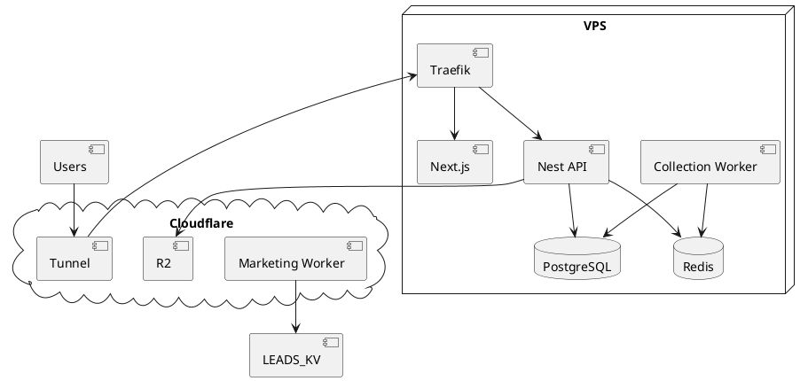

---

## Appendix K — Decision Log Snapshot

| Decision                     | Status                              |
| ---------------------------- | ----------------------------------- |
| Keep marketing on Cloudflare | Recommended                         |
| Greenfield Nest SaaS         | Recommended                         |
| SSE over Socket.IO for MVP   | Recommended                         |
| Shared DB multi-tenant       | Recommended                         |
| No K8s/AWS MVP               | Mandated by brief + accepted        |
| Python port from this repo   | **Rejected** — nothing to port here |

---

## Appendix L — Glossary

| Term          | Meaning                               |
| ------------- | ------------------------------------- |
| Organization  | Tenant billing boundary               |
| Workspace     | Optional sub-area inside org          |
| CollectionJob | Async acquire/enrich unit             |
| EmailAsset    | Stored generated outreach copy        |
| Agent tool    | Typed backend function exposed to LLM |
| DLQ           | Dead letter queue for failed jobs     |
| Outbox        | PG table for reliable event publish   |

---

## Appendix M — Technology Matrix (Expanded)

| Concern          | Current repo (verified) | MVP SaaS (recommended) | Later                     |
| ---------------- | ----------------------- | ---------------------- | ------------------------- |
| Public website   | Vite React SPA          | Keep                   | Optionally Next marketing |
| Product UI       | Mockups only            | Next.js                | Microfrontends unlikely   |
| API              | CF Worker contact       | NestJS                 | Gateway + services        |
| Jobs             | None                    | BullMQ                 | Dedicated clusters        |
| DB               | KV leads                | PostgreSQL             | Replicas                  |
| Cache/queue      | None                    | Redis                  | Split roles               |
| Files            | Static assets           | R2                     | Same                      |
| Auth             | None                    | Cookie sessions        | SSO                       |
| AI               | Unused dep              | Tool-calling agent     | Fine-tunes                |
| Realtime         | None                    | SSE                    | Socket gateway            |
| Deploy marketing | Wrangler                | Same                   | Same                      |
| Deploy SaaS      | N/A                     | Compose VPS            | Orchestrator              |

---

## Appendix N — Migration Checklist (Executable)

### Discovery

- [ ] Confirm whether an external Python/`rust_core` codebase exists
- [ ] Inventory any production scrapers/enrichers outside this repo
- [ ] Confirm business model: SaaS vs managed hybrid

### Platform bootstrap

- [ ] Create monorepo `adealforge-platform`
- [ ] Add `api`, `worker`, `web` apps
- [ ] Add Prisma + PostgreSQL + Redis Compose
- [ ] Configure Cloudflare Tunnel to VPS
- [ ] Configure R2 buckets (`imports`, `exports`, `backups`)

### Security baseline

- [ ] Secrets management process
- [ ] RBAC matrix signed off
- [ ] Tenant isolation test suite gate in CI
- [ ] SSRF protections for collectors

### Product MVP

- [ ] Auth + orgs
- [ ] CRM CRUD + CSV
- [ ] Collection jobs v1
- [ ] AI email generate/regenerate
- [ ] Agent tools subset
- [ ] Campaign launch/pause
- [ ] Stripe skeleton

### Marketing continuity

- [ ] Keep Worker contact form live
- [ ] Optional: export KV leads weekly
- [ ] Align pricing placeholders with real billing

### Launch gate

- [ ] Load test basic APIs
- [ ] Backup restore drill
- [ ] Legal review of collection sources
- [ ] CTO sign-off on ADRs

---

_Appendices end. Document complete for PDF export._

---

## Appendix O — Component-Level Inventory (Verified Source Review)

### O.1 Frontend component inventory

| Area        | Files (representative)                                         | Role                                     |
| ----------- | -------------------------------------------------------------- | ---------------------------------------- |
| Shell       | `App.tsx`, `main.tsx`, `Navbar.tsx`, `Footer.tsx`              | SPA shell + custom path routing          |
| Home        | `home-v2/HomepageV3Page.tsx` + section components              | Production homepage                      |
| Legacy home | `HomepageV1Page.tsx`, `HomepageV2Page.tsx`                     | Retained source; routes redirected       |
| Workflow    | `WorkflowPage.tsx`, `MainProductMockup.tsx`                    | Product story mock dashboard             |
| Platform    | `PlatformPage.tsx`, `PlatformOverviewStrip.tsx`                | Explicit under-construction product page |
| Contact     | `ContactPage.tsx`, map/social sections                         | Lead capture UI                          |
| Pricing     | `PricingSection.tsx`, `HomeV2PricingPreview.tsx`, pricing libs | Commercial presentation + A/B            |
| Trust/proof | Testimonials, FAQ, ProofBand, DataQuality                      | Conversion content                       |
| Legal       | `TermsPage.tsx`, `TermsDocument.tsx`                           | Terms surface                            |
| Motion/perf | `DeferredMount.tsx`, live campaign simulation                  | UX polish; not backend                   |

### O.2 Library modules

| Module                           | Verified behavior                |
| -------------------------------- | -------------------------------- |
| `analytics.ts`                   | GA4 load only after consent path |
| `cookieConsent.ts`               | Cookie banner integration        |
| `pricingAbTest.ts`               | localStorage A/B assignment      |
| `homepageOneTimeLeadsPricing.ts` | Placeholder one-time packages    |
| `homepageSections.ts`            | Section id/href helpers          |
| `siteContact.ts`                 | Shared email/WhatsApp helpers    |
| `modalManager.ts`                | Modal coordination               |
| `useSiteCopy.ts`                 | i18n/content access helper       |

### O.3 Worker capabilities boundary

The Worker is intentionally small. It does:

- Contact POST handling
- Turnstile verification
- KV persistence
- SPA path rewrites / legacy redirects
- Asset passthrough

It does **not** do authentication, tenancy, scraping, AI, campaigns, or billing.

### O.4 What “campaign” means in this repo

In product companies like Instantly/Smartlead, “campaign” implies sender infrastructure, sequences, and events. In this repository, “campaign” appears as:

1. Marketing narrative (“live campaign support”).
2. UI mock metrics in workflow stages.
3. `useLiveCampaignSimulation` client animation.

Therefore any campaign microservice design is **target architecture**, not migration of existing code.

---

## Appendix P — Threat Model (MVP SaaS)

### Assets

- Tenant CRM data (companies, people, emails)
- Auth credentials/sessions
- LLM prompts containing customer ICP/offers
- API keys (LLM, Maps, Stripe)
- Exported CSV artifacts in R2
- Marketing lead PII in KV (current)

### Actors

- Honest tenant users
- Malicious tenant users (prompt injection, quota abuse)
- External attackers (credential stuffing, SSRF via collectors)
- Compromised dependencies
- Insider threats (support access)

### STRIDE highlights

| Category               | Example                        | Mitigation                                |
| ---------------------- | ------------------------------ | ----------------------------------------- |
| Spoofing               | Stolen session                 | httpOnly cookies, rotation, device logout |
| Tampering              | Job payload rewrite            | Sign job ids; load payload from PG        |
| Repudiation            | Denied campaign launch         | Audit logs                                |
| Information disclosure | Cross-tenant read              | orgId enforcement + tests                 |
| Denial of service      | Scrape flood                   | Quotas + CF + Redis limits                |
| Elevation              | Member launches billing change | RBAC                                      |

---

## Appendix Q — Capacity Planning Notes

### MVP sizing assumption

- 50 orgs, 200 seats, 100k companies total, 20 concurrent collection jobs, 10 concurrent LLM streams.

### VPS sizing guidance

| RAM   | Fits                            |
| ----- | ------------------------------- |
| 4 GB  | Tight (PG+Redis+API+web+worker) |
| 8 GB  | Comfortable MVP                 |
| 16 GB | Headroom for larger imports     |

### PostgreSQL indexes (early)

- `(organization_id, domain)` unique on companies
- `(organization_id, email)` unique on people
- `(organization_id, created_at)` on jobs/campaigns
- GIN/trgm optional for name search later

---

## Appendix R — Event Catalog (Extension Points for Automation)

> Future no-code builder consumes these; MVP only persists/outbox.

| Event                          | Payload gist             |
| ------------------------------ | ------------------------ |
| `organization.created`         | orgId, plan              |
| `membership.invited`           | orgId, email, role       |
| `company.created`              | orgId, companyId         |
| `person.created`               | orgId, personId          |
| `collection_job.completed`     | orgId, jobId, counts     |
| `email_asset.generated`        | orgId, personId, assetId |
| `campaign.launched`            | orgId, campaignId        |
| `campaign.paused`              | orgId, campaignId        |
| `agent.tool_executed`          | orgId, tool, status      |
| `billing.subscription_updated` | orgId, status            |

---

## Appendix S — Agent Tool Contracts (Sketch)

```ts
type ToolContext = { organizationId: string; userId: string; roles: string[] };

// search_prospects
input: { query: string; limit?: number }
output: { companies: Array<{ id: string; name: string; domain?: string }> }

// generate_email
input: { personId: string; tone?: string; language?: string }
output: { emailAssetId: string; subject: string; body: string }

// launch_campaign
input: { campaignId: string; confirm: true }
output: { status: 'running' }
// Requires Admin/Owner or explicit entitlement; HITL confirm flag mandatory in early MVP.
```

---

## Appendix T — Observability Field Standard

Every log line / span should attempt:

```json
{
  "ts": "ISO-8601",
  "level": "info|warn|error",
  "service": "api|worker|web",
  "requestId": "uuid",
  "organizationId": "cuid|null",
  "userId": "cuid|null",
  "jobId": "cuid|null",
  "msg": "human message",
  "err": { "type": "", "message": "" }
}
```

---

## Appendix U — Cutover Runbook (Marketing → SaaS Intake)

1. Keep `/api/contact` writing to KV.
2. Add dual-write Worker → platform `LeadInquiry` API (signed service token).
3. Validate parity for 1–2 weeks.
4. Switch Worker to platform-only write.
5. Export historical KV → PG.
6. Decommission KV namespace after retention window.

---

## Appendix V — Open Source / License Hygiene

- Confirm license compatibility for Nest/Prisma/BullMQ/Next (MIT-friendly stack).
- Marketing repo currently Apache-2.0 header in `App.tsx` — confirm corporate policy.
- Do not vendor GPL scrapers into core without legal review.

---

## Appendix W — Comparison Anchors (Product Architecture Analogues)

| Analogue          | Relevant subsystem pattern            |
| ----------------- | ------------------------------------- |
| Apollo.io         | CRM search + enrichment + sequences   |
| Instantly.ai      | Campaign sender + warmup ops          |
| Clay              | Enrichment graph / provider waterfall |
| HubSpot           | Multi-tenant CRM + marketing hub      |
| Smartlead/Lemlist | Deliverability-centric outreach       |

ADealForge MVP should **not** clone all at once. Closest initial wedge from current marketing: **ICP list building + enrichment context + AI first-touch drafts**, with campaigns as state machine first and sending adapters second.

---

## Appendix X — Explicit Non-Goals for Phase 1

1. Building Kubernetes manifests
2. Multi-region active-active
3. Full LinkedIn automation
4. Visual workflow builder UI
5. Replacing marketing site with Next.js immediately
6. Inventing a Python migration plan without a Python codebase present

---

## Appendix Y — Reviewer Sign-off Template

| Reviewer | Area                  | Decision        | Date |
| -------- | --------------------- | --------------- | ---- |
| CTO      | ADRs 001–012          | Approve / Amend |      |
| Eng Lead | MVP scope             |                 |      |
| Security | Tenancy + SSRF        |                 |      |
| Legal    | Collection sources    |                 |      |
| Product  | Self-serve vs managed |                 |      |
| Finance  | Monthly cost ceiling  |                 |      |

---

## Appendix Z — Document Generation Notes

- Source of truth: `Architecture.md`
- Diagrams: `docs/architecture/diagrams/*.mmd`
- Checklists: `docs/architecture/Migration-Checklist.md`
- PDF generated after compliance gate (all boss requirements Completed)
- Canvas summary available beside chat for executive skim

_End of Architecture Design Document_

---

## Appendix AA — Main API Module Design (Recommended)

### Module boundaries

1. **AuthModule** — credentials, sessions, password reset tokens, OAuth stubs.
2. **TenancyModule** — organizations, memberships, invitations, workspace switching.
3. **CrmModule** — companies, people, lists, tags, notes.
4. **ImportExportModule** — CSV parsers, R2 artifact pointers, mapping templates.
5. **CollectionOrchestrationModule** — creates jobs, ACL checks, SSE fan-out (execution in worker).
6. **AiModule** — prompt templates, provider clients, EmailAsset persistence, usage ledger.
7. **AgentModule** — threads/messages, tool registry, policy checks, HITL gates.
8. **CampaignModule** — campaigns, sequence steps, memberships, launch state machine.
9. **BillingModule** — Stripe customer mapping, entitlements cache invalidation.
10. **AuditModule** — append-only audit records + query API for owners.
11. **HealthModule** — liveness/readiness.

### Cross-cutting Nest providers

- TenantContext request-scoped provider
- IdempotencyInterceptor
- AuditInterceptor for mutating routes
- EntitlementsGuard

### Why modular monolith processes (not many repos yet)

Running pi and worker from one codebase with two entrypoints minimizes duplication while preserving a future split of Data Collection into its own deployable when queue depth or dependency risk demands it.

---

## Appendix AB — Data Collection Adapter Policy

Every adapter MUST implement:

1. alidateInput(job) — schema + SSRF checks
2. estimateCost(job) — quota preflight
3. execute(job, ctx) — returns normalized records
4. checkpoint(job, cursor) — resumability
5. mapError(err) — retryable vs fatal classification

### Normalized company record

`json
{
  "name": "string",
  "domain": "string|null",
  "country": "string|null",
  "region": "string|null",
  "sector": "string|null",
  "source": "website|maps|registry|csv",
  "sourceUrl": "string|null",
  "confidence": 0.0,
  "rawRef": "r2://..."
}
`

### Legal/compliance hooks

- Per-source
  obotsPolicy flag
- Per-org llowedCountries
- Global kill switch env COLLECTION_ENABLED=false

---

## Appendix AC — Frontend Information Architecture (Product)

Primary nav (MVP):

1. Home / Dashboard
2. Prospects (Companies / People / Lists)
3. Collection Jobs
4. Emails
5. Campaigns
6. Agent
7. Settings (members, billing, API keys later)

Empty states should push users into: import CSV OR start collection OR ask agent.

---

## Appendix AD — Test Strategy for New Platform

| Layer       | MVP expectation                                         |
| ----------- | ------------------------------------------------------- |
| Unit        | Domain services, adapters mocks                         |
| Integration | Prisma + Redis testcontainers or Compose                |
| E2E         | Playwright critical paths (login, import, generate)     |
| Security    | Tenant isolation suite (must fail CI on cross-org read) |
| Load        | k6 smoke on list endpoints before beta                  |

Frontend product tests: follow team rule that frontend may skip heavy unit tests; rely on Playwright for critical flows.

---

## Appendix AE — Success Metrics (Architecture Outcomes)

1. Time to deploy staging < 30 minutes for a new engineer following runbook.
2. Monthly infra under agreed ceiling without AWS/K8s.
3. Zero verified cross-tenant reads in penetration tests.
4. p95 job start latency < 2s after enqueue under MVP load.
5. Marketing site remains independently deployable.
